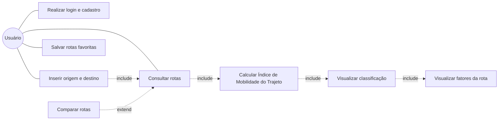
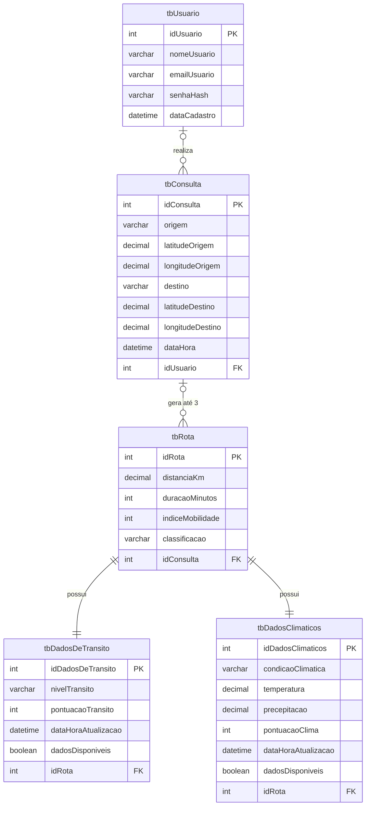

# UrbanFlow

**Monitoramento Inteligente do Fluxo e Estresse Urbano**

Projeto Integrador · Análise e Desenvolvimento de Sistemas · Fatec Ferraz de Vasconcelos · 2026

**Status:** em desenvolvimento

---

## Sumário

- [Sobre o projeto](#sobre-o-projeto)
- [Por que o UrbanFlow existe](#por-que-o-urbanflow-existe)
- [Como funciona](#como-funciona)
- [Funcionalidades](#funcionalidades)
- [Caso de uso](#caso-de-uso)
- [Modelo de dados](#modelo-de-dados)
- [Tecnologias](#tecnologias)
- [Estrutura do repositório](#estrutura-do-repositório)
- [Como executar](#como-executar)
- [Próximos passos](#próximos-passos)
- [Metodologia](#metodologia)
- [Equipe](#equipe)

---

## Sobre o projeto

O **UrbanFlow** é um sistema de apoio à decisão para quem se desloca pela cidade. Em vez de olhar só para o menor tempo ou a menor distância, ele cruza dados de **trânsito** e **clima** e resume cada trajeto em uma nota: o **Índice de Mobilidade do Trajeto**.

Com essa nota, o usuário compara até três rotas e escolhe a mais favorável antes de sair de casa.

**Para quem:** estudantes, trabalhadores, motoristas e qualquer pessoa em deslocamento urbano.

**Escopo:** aplicativo mobile e site institucional.

## Por que o UrbanFlow existe

Escolher uma rota vai além do relógio. Hoje, o motorista alterna entre o mapa, a previsão do tempo e os alertas de trânsito, e precisa cruzar tudo sozinho, muitas vezes já dirigindo.

Alguns dados que motivaram o projeto:

- **Ansiedade:** segundo a OMS, 9,3% da população brasileira convive com transtornos de ansiedade, a maior proporção do mundo ([OPAS/OMS, 2017](https://www.paho.org/pt/noticias/23-2-2017-aumenta-numero-pessoas-com-depressao-no-mundo)).
- **Trânsito:** o Brasil registrou 37.150 mortes no trânsito em 2024, o quinto ano seguido de alta ([ONSV, dados do Ministério da Saúde](https://www.portaldotransito.com.br/noticias/fiscalizacao-e-legislacao/estatisticas/mortes-no-transito-avancam-pelo-quinto-ano-seguido-no-brasil-aponta-analise-do-onsv/?noamp=mobile)).
- **Saúde do motorista:** 28% dos sinistros nas rodovias federais entre 2014 e 2024 envolveram problemas de saúde do condutor, como sono, falta de atenção e transtornos mentais ([Abramet, via Agência Brasil](https://agenciabrasil.ebc.com.br/saude/noticia/2026-05/transtornos-de-saude-causaram-28-dos-sinistros-em-rodovias-do-pais)).
- **Chuva:** a chuva agrava o risco. No Ceará, as mortes em rodovias federais na temporada de chuvas subiram 24% de um ano para o outro ([PRF, via O Povo](https://mais.opovo.com.br/jornal/cidades/2026/04/03/mortes-em-rodovias-federais-durante-quadra-chuvosa-tem-aumento-de-24-no-ce.html)).

O objetivo do UrbanFlow é tirar a surpresa do caminho, para que o motorista não precise decidir no susto.

O projeto está alinhado à **Política Nacional de Mobilidade Urbana** (Lei nº 12.587/2012) e aos **Objetivos de Desenvolvimento Sustentável 3, 9 e 11** da ONU: saúde e bem-estar; indústria, inovação e infraestrutura; cidades e comunidades sustentáveis.

## Como funciona

1. O usuário informa a origem e o destino.
2. O sistema busca até três rotas possíveis.
3. Para cada rota, calcula o **Índice de Mobilidade do Trajeto**, de 0 a 100:

```
Índice = 0,6 × pontuação de trânsito + 0,4 × pontuação de clima
```

4. A rota recebe uma classificação:

| Índice | Classificação | Significado |
|:---:|:---:|---|
| 0 a 39 | 🟢 **Tranquila** | Caminho livre e condições ótimas |
| 40 a 69 | 🟡 **Equilibrada** | Exige atenção, mas flui bem |
| 70 a 100 | 🔴 **Ruim** | Trânsito pesado ou clima desfavorável no momento |

**Exemplo:** uma rota com trânsito 90 e clima 60 tem índice 0,6 × 90 + 0,4 × 60 = **78**, ou seja, **Ruim**.

Se os dados de trânsito ou de clima estiverem indisponíveis, o aplicativo avisa o usuário em vez de mostrar uma nota incompleta.

## Funcionalidades

- Cadastro e login de usuário
- Busca por origem e destino
- Consulta de até três rotas ao mesmo tempo
- Comparação entre as rotas
- Índice de Mobilidade e classificação de cada rota
- Fatores do trajeto: trânsito, clima e condição da via
- Alerta de chuva antes de sair
- Rotas favoritas (casa, trabalho, faculdade)

## Caso de uso



## Modelo de dados

O banco tem cinco tabelas. Cada consulta gera até três rotas, e cada rota tem um registro de trânsito e um de clima.



> Os tipos das colunas no diagrama são indicativos. A referência é o script do banco.

**Segurança e LGPD:** a senha é armazenada apenas em hash (`senhaHash`), e as tabelas são ligadas por chaves primárias e estrangeiras para garantir a integridade referencial.

## Tecnologias

**Em uso**

| Área | Ferramentas |
|---|---|
| Desenvolvimento | Visual Studio Code, HTML5, CSS3, JavaScript (estrutura responsiva) |
| Banco de dados | MySQL |
| Versionamento e equipe | Git, GitHub, Trello, WhatsApp |
| Inteligência artificial | Claude, como apoio no material visual e na documentação |

**Planejado**

| Item | Situação |
|---|---|
| Aplicativo mobile Android e iOS | Framework em definição: Kotlin ou uma opção multiplataforma |
| APIs de mapas, trânsito e clima | Em avaliação, para alimentar o Índice de Mobilidade com dados reais |

## Estrutura do repositório

```
📁 web/              site institucional
├── index.html       página principal: introdução, necessidade e objetivo
├── about.html       quem somos
├── script.js        interações
└── styles.css       visual e responsividade

📁 projeto/          protótipo do aplicativo
├── index.html       telas do protótipo
├── script.js        lógica e interações
└── style.css        visual
```

Cada arquivo tem um papel: **HTML** para a estrutura, **CSS** para o visual e **JavaScript** para o comportamento.

## Como executar

O site e o protótipo são páginas estáticas, então não precisam de instalação.

```bash
git clone <url-deste-repositório>
```

Depois, abra o `index.html` da pasta desejada no navegador.

## Próximos passos

- [x] Documentação e modelagem (caso de uso e DER)
- [x] Protótipo de baixa fidelidade
- [x] Protótipo da interface e site institucional
- [ ] Finalizar a implementação e integrar com dados reais de trânsito e clima
- [ ] Testes de segurança e adequação à LGPD
- [ ] Aplicativo mobile para Android e iOS
- [ ] Entrega produtiva

## Metodologia

O projeto é desenvolvido com **Scrum**, organizado em sprints no Trello.

| Papel | Responsável |
|---|---|
| Scrum Master | Pedro Luís Reis do Nascimento |
| Product Owner | Leonardo Sousa da Silva |
| Time de desenvolvimento | Gerson Pinheiro de Oliveira, Leonardo Sousa da Silva e Pedro Luís Reis do Nascimento |

## Equipe

| Integrante | Papel no Scrum |
|---|---|
| **Gerson Pinheiro de Oliveira** | Desenvolvimento |
| **Leonardo Sousa da Silva** | Product Owner e desenvolvimento |
| **Pedro Luís Reis do Nascimento** | Scrum Master e desenvolvimento |

**Orientação:** Francisco Douglas de Abreu

**Instituição:** Fatec Ferraz de Vasconcelos, curso de Análise e Desenvolvimento de Sistemas

---

*UrbanFlow · rotas mais eficientes, cidades mais sustentáveis.*
